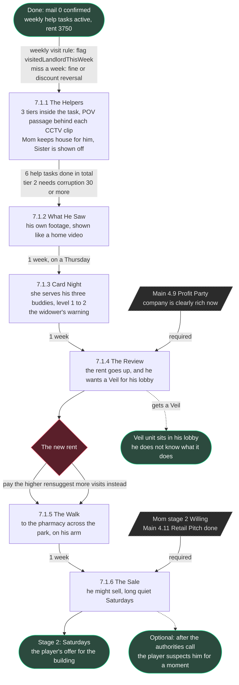
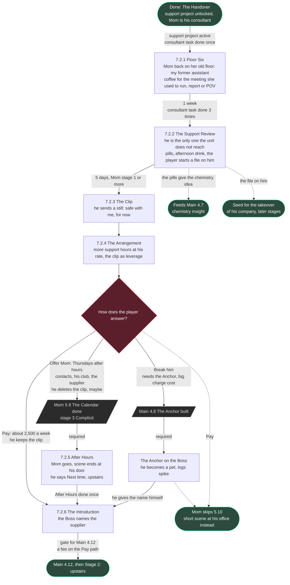
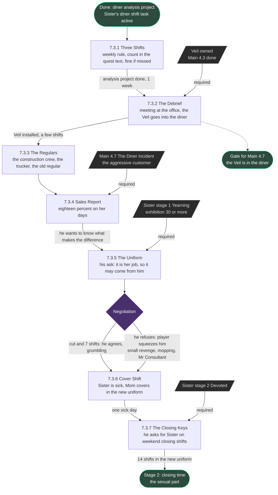
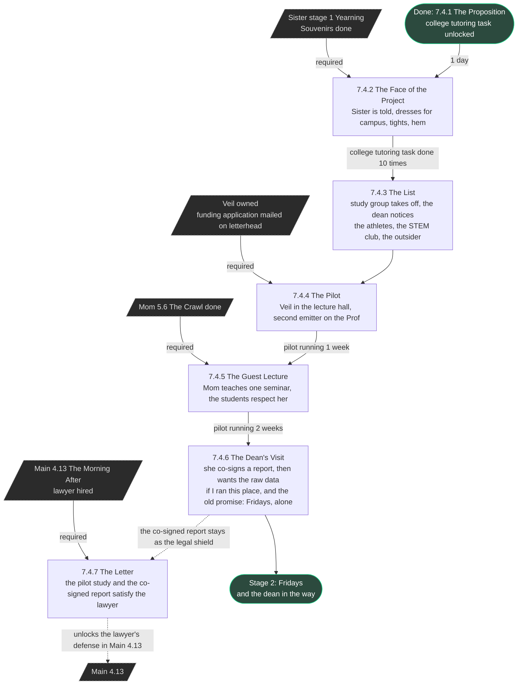
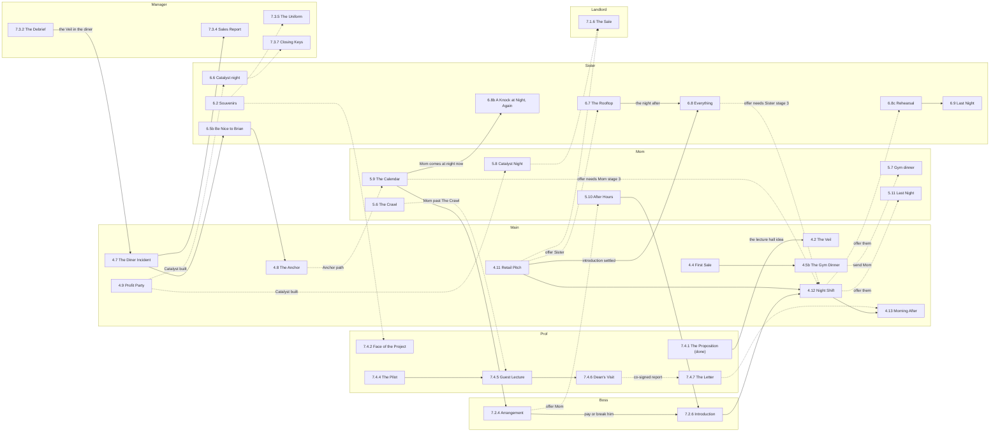

# Stage 1 flowcharts

Companion to [STAGE1_PROPOSAL.md](STAGE1_PROPOSAL.md). One chart per section: the main line (4), Mom (5), Sister (6) and the four side lines (7). The last two charts show only the links *between* lines, and everything at once.

**To see them in VS Code:** install the extension "Markdown Preview Mermaid Support" (`bierner.markdown-mermaid`), then open the preview (`Ctrl+Shift+V`). GitHub and most Markdown viewers render them without anything extra.

**How to read them**

| Shape | Meaning |
|---|---|
| Rectangle | A quest or scene (the number is the section in the proposal) |
| Diamond | A player choice |
| Red diamond | A **family option** (proposal 3.1): pay the plain price, or offer Mom or Sister instead. Never strictly required. |
| Hexagon | A corruption stage milestone (the bar is full, the scene advances her stage) |
| Parallelogram | A gate from *another* line. It must be done before the arrow's target can happen. |
| Stadium (pill) | Already in the game, or a hand-off to another line or to Stage 2 |
| Solid arrow | Next step in the same line. The label is the requirement. |
| Dotted arrow | Optional, or a hand-off to another line: this scene unlocks or feeds that one |

Numbers in the requirements (days, counts, prices) are starting values to tune, not fixed rules. "Stage 2 Willing" and so on are the corruption stages from the proposal. A family option is only offered once she's ready (corruption and exhibition); until then it shows as locked.

---

## 4. Main line

```mermaid
flowchart TD
  S0(["Done: It'll be official<br/>official product project exists"]):::done

  G0[/"Prof The Proposition done<br/>the lecture hall idea"/]:::gate
  M2["4.2 The Veil<br/>team meeting, Veil project starts"]
  M3["4.3 The Late Night<br/>tuning with Ethan, vent off for one night"]
  M4["4.4 First Real Sale<br/>her mail, her call, the bar, flag pressClient"]

  M5a["4.5a The Gym Meeting<br/>Darius's old friend, corporate talk<br/>router redesign, he wants a dinner"]
  F1{"4.5b The Gym Dinner:<br/>who goes?"}:::offer
  G1[/"Mom 5.7 The Gym Dinner<br/>told in her end-of-day report"/]:::gate
  M5(["Gym contract signed"]):::done
  M6["4.6 Morale<br/>staff dress code, Darius pushes back"]
  D1{"Let Darius in?"}:::choice
  G2[/"Manager 7.3.2 The Debrief<br/>the Veil is in the diner, 10 diner shifts"/]:::gate
  M7["4.7 The Diner Incident<br/>told in her report, chemistry matters"]
  G3[/"Sister 6.5b Be Nice to Brian<br/>Brian is easier to talk to"/]:::gate
  M8["4.8 The Anchor<br/>built with Brian only"]
  M9["4.9 The Profit Party<br/>Catalyst announced, the investor mentioned,<br/>Ethan gets a token 2 percent"]
  C1(["Catalyst project runs and completes<br/>device Catalyst owned"]):::done
  M10["4.10 The Crack<br/>Ethan tries the full code on himself"]
  M10b["Player accuses Darius<br/>the log pull used Darius's login"]
  F2{"The retail chain<br/>introduction"}:::offer
  G4[/"Sister 6.7 The Rooftop<br/>she hosts the investor evening"/]:::gate
  M11["4.11 The Retail Pitch<br/>Ethan sets up, gets master access"]
  G5[/"Boss 7.2.6 The Introduction<br/>the supplier is named"/]:::gate
  M12["4.12 The Night Shift<br/>the supplier wants 20,000 dollars or an evening"]
  F3{"The supplier's price"}:::offer
  G7[/"Mom 5.11 and Sister 6.9<br/>The Last Night, ends at the club door"/]:::gate
  D3{"Ethan calls at 11:40 pm"}:::choice
  G6[/"Prof 7.4.6 The Dean's Visit<br/>the co-signed report, the shield for the lawyer"/]:::gate
  M13["4.13 The Morning After<br/>heist, investigation, lawyer, Dana's press"]
  S2(["Stage 2"]):::done

  S0 --> M2
  G0 -->|"required"| M2
  M2 -->|"Veil project at 80 percent"| M3
  M3 -->|"Veil project complete, Veil owned<br/>a couple of days later, her mail"| M4
  M4 -->|"a few days later, Rick's mail<br/>Darius hired, Veil owned"| M5a
  M5a -->|"dinner scheduled"| F1
  F1 -->|"send Mom: full contract<br/>needs her ready"| G1
  G1 --> M5
  F1 -->|"go himself: 20 percent discount"| M5
  M5 -->|"1 week of heavier workload"| M6
  M6 --> D1
  D1 -->|"half-truth: flag dariusAlly"| M7
  D1 -->|"shut him out: flag dariusSuspicious"| M7
  G2 -->|"required"| M7
  M7 --> M8
  G3 -->|"required"| M8
  M8 -->|"company account in the black"| M9
  M9 --> C1
  C1 -.->|"unlocks Mom 5.8<br/>and Sister 6.6"| C2[/"Mom 5.8 and Sister 6.6<br/>Catalyst nights"/]:::gate
  C1 -->|"a weekend, Ethan alone in the office"| M10
  M10 --> M10b
  M10b -->|"Darius forgives fast if dariusAlly"| F2
  F2 -->|"offer Sister as hostess: free<br/>needs her ready"| G4
  G4 --> M11
  F2 -->|"pay the broker, about 15,000<br/>or wait 2 weeks"| M11
  M11 -->|"demo prepared<br/>flag trustedEthan"| M12
  G5 -->|"required"| M12
  M12 --> F3
  F3 -->|"offer them<br/>needs both at stage 3"| G7
  G7 --> D3
  F3 -->|"pay: account emptied, a loan<br/>or a project cancelled"| D3
  D3 -->|"answer: tomorrow"| M13
  D3 -->|"ignore: voicemail"| M13
  G6 -.->|"lawyer asks for proof of research"| M13
  M13 --> S2

  classDef done fill:#2c4a3e,stroke:#1cd88d,color:#fff
  classDef choice fill:#47306b,stroke:#b08bff,color:#fff
  classDef offer fill:#5a1f2a,stroke:#ff6479,color:#fff
  classDef gate fill:#2b2b2b,stroke:#999,color:#ddd,stroke-dasharray:4 3
```

---

## 5. Mom's line

```mermaid
flowchart TD
  S0(["Done: A Knock at Night<br/>Handjob card unlocked, stage 1 Dutiful"]):::done

  A1["5.1 The Booze Night<br/>quiet, no device, passive lust builds"]
  A2["5.2 Caught<br/>meeting room, Brian nearly walks in"]
  A3["5.3 Flirt Duty<br/>comedy, coaching scene, new task with a POV passage"]
  A4["5.4 Not Enough<br/>she refuses, he scoffs"]
  A5["5.5 The Silence<br/>a week of cold, no interactions"]
  A6["5.6 The Crawl<br/>Friday at the empty office"]
  G0[/"Main 4.5b The Gym Dinner<br/>player sent Mom"/]:::gate
  A7["5.7 The Gym Dinner<br/>told in her end-of-day report: Was that right?"]
  D1{"What he tells her<br/>before she goes"}:::choice
  A8H{{"Stage 2: Willing"}}:::milestone
  A8["5.8 The Catalyst Night<br/>first full sex, no rule this time"]
  G1[/"Main 4.9 Catalyst project complete"/]:::gate
  E1["Ethan asks Mom if she is okay<br/>short scene, feeds main 4.10"]
  A9["5.9 The Calendar<br/>she circles the pattern: Is it the box?"]
  D2{"Her question"}:::choice
  A9H{{"Stage 3: Complicit<br/>interaction Whenever unlocks"}}:::milestone
  G2[/"Boss 7.2.4 The Arrangement<br/>player offered Mom"/]:::gate
  A10["5.10 After Hours<br/>the walk to the car, ends at the Boss's door"]
  A10b["No After Hours<br/>short scene at his office instead"]
  M12(["Main 4.12 The Night Shift"]):::done
  A11["5.11 The Last Night<br/>in the outfit he picked, rides to the club"]
  M13(["Main 4.13 The Morning After"]):::done

  S0 -->|"3 days"| A1
  A1 -->|"lust 60 or more<br/>she is alone in the meeting room"| A2
  A2 -->|"5 handjobs, flag handjobs"| A3
  A3 -->|"Flirt Duty task done 3 times<br/>lust 80 or more"| A4
  A4 -->|"automatic, 7 days"| A5
  A5 -->|"no interaction with her for 7 days<br/>a Friday, player stays late"| A6
  A6 -->|"first blowjob done"| A7
  G0 -->|"required"| A7
  A6 -->|"he went to the gym himself"| A8H
  A7 --> D1
  D1 -->|"Let him: more goodwill<br/>resistance up, feelings toward him down"| A8H
  D1 -->|"Keep it light: she is at ease"| A8H
  A8H -->|"bar full, resistance 50 or less"| A8
  G1 -->|"required"| A8
  A8 -.->|"after the night"| E1
  A8 -->|"7 days, she keeps the calendar"| A9
  A9 --> D2
  D2 -->|"tell her part of the truth<br/>she says the mirror line"| A9H
  D2 -->|"use the Anchor<br/>logs spike, Ethan sees it"| A9H
  A9H -->|"Boss: offered Mom"| A10
  G2 -->|"required"| A10
  A9H -->|"Boss: paid or broken"| A10b
  A10 --> M12
  A10b --> M12
  M12 -->|"player offered them to the supplier"| A11
  M12 -->|"player paid"| M13
  A11 --> M13

  classDef done fill:#2c4a3e,stroke:#1cd88d,color:#fff
  classDef choice fill:#47306b,stroke:#b08bff,color:#fff
  classDef milestone fill:#6b4100,stroke:#EAAF4C,color:#fff
  classDef gate fill:#2b2b2b,stroke:#999,color:#ddd,stroke-dasharray:4 3
```

---

## 6. Sister's line

```mermaid
flowchart TD
  S0(["Done: Good News?<br/>stage 0 Conflicted, works at the office from noon"]):::done

  B1["6.1 The Ask<br/>Darius asks her out, she says no on her own<br/>he is the only one she wants"]
  B2["6.2 Souvenirs<br/>the photos, her first handjob"]
  B2H{{"Stage 1: Yearning"}}:::milestone
  B3["6.3 Office Gossip<br/>comedy, her first end-of-day reports"]
  B4["6.4 Send Me Something<br/>videos at night on his phone, then he walks in"]
  B5["6.5 What Are We<br/>she cannot say the old word anymore"]
  G4[/"Main 4.7 The Diner Incident<br/>he wants Brian on his side"/]:::gate
  B5b["6.5b Be Nice to Brian<br/>comedy, task with a POV passage<br/>her first order about someone else"]
  X2(["Main 4.8 The Anchor"]):::done
  G1[/"Main 4.9 Catalyst project complete"/]:::gate
  B6H{{"Stage 2: Devoted"}}:::milestone
  B6["6.6 The Catalyst, first night<br/>love turned into obligation"]
  B6b["6.6b Two Towns Over<br/>a real date, a classmate walks in"]
  D2{"Who answers first?"}:::choice
  B6c["6.6c The Friend<br/>she turns down the lake weekend<br/>and mutes the group chat"]
  M11(["Main 4.11<br/>the retail introduction is settled"]):::done
  B7["6.7 The Rooftop<br/>investor evening, the signal across the room"]
  B8["6.8 Everything<br/>submit or leave, she asks him to pick her clothes: Soon"]
  B8H{{"Stage 3: Mine"}}:::milestone
  G5[/"Mom 5.9 The Calendar done<br/>Mom comes at night when she likes"/]:::gate
  B8b["6.8b A Knock at Night, Again<br/>Mom at the door, Sister in his bed"]
  D3{"Through the door"}:::choice
  M12(["Main 4.12 The Night Shift"]):::done
  B8c["6.8c Rehearsal<br/>he plays the supplier, device off<br/>Will you be there? Outside."]
  B9["6.9 The Last Night<br/>she is the hostess, the car"]
  M13(["Main 4.13 The Morning After"]):::done

  S0 -->|"5 days<br/>rounds task done 3 times"| B1
  B1 -->|"1 week"| B2
  B2 -->|"7 days, bar full, flag photoTaken"| B2H
  B2H --> B3
  B3 -->|"Internship Overview done 4 times<br/>her stage 1"| B4
  B4 -->|"lust 60 or more<br/>3 gossip reports heard"| B5
  B5 -->|"2 videos sent"| B5b
  G4 -->|"required"| B5b
  B5b -.->|"done about 3 times"| X2
  B5b --> B6H
  G1 -->|"required"| B6H
  B6H --> B6
  B6 -->|"a few days, a weekend evening"| B6b
  B6b --> D2
  D2 -->|"boyfriend: she glows<br/>flag datePhoto"| B6c
  D2 -->|"brother: a quiet ride home<br/>feelings toward him down"| B6c
  B6c -->|"about 1 week"| M11
  M11 -.->|"player offered her as hostess<br/>exhibition 40 or more"| B7
  B7 -->|"the night after"| B8
  M11 -->|"player paid the broker or waited"| B8
  B8 --> B8H
  B8H -->|"a few nights later, both at home"| B8b
  G5 -->|"required"| B8b
  B8b --> D3
  D3 -->|"Not tonight: Mom leaves hurt"| M12
  D3 -->|"Let her in: tea, she almost sits on Sister"| M12
  M12 -->|"player offered them to the supplier"| B8c
  B8c -->|"the next evening"| B9
  M12 -->|"player paid"| M13
  B9 --> M13

  classDef done fill:#2c4a3e,stroke:#1cd88d,color:#fff
  classDef choice fill:#47306b,stroke:#b08bff,color:#fff
  classDef milestone fill:#6b4100,stroke:#EAAF4C,color:#fff
  classDef gate fill:#2b2b2b,stroke:#999,color:#ddd,stroke-dasharray:4 3
```

---

## 7. Side lines

Each chart is one line. The currency is what the player ends up holding, the venue is where Mom and Sister end up in the later stages ([LATER_STAGES_VISION.md](LATER_STAGES_VISION.md)). Revised 2026-11-20 together with proposal section 7.

### 7.1 Landlord (currency: the building, venue: his apartment, card nights, outings)

### 7.2 Boss (currency: connections and the supplier, venue: floor 6 and upstairs)

### 7.3 Manager (currency: a cut of the diner, venue: the diner)

### 7.4 Prof (currency: legitimacy, venue: the college)

---

## Cross-line gates only

This chart drops everything inside a line and keeps the links between them. If a scene is stuck, look here for what it is waiting on. Dotted arrows marked "offer" are family options: they only happen if the player chooses them.

---

## Everything in one chart

All lines in one flowchart, starting from where the game stands now. The last scene already written in each line is the first node of its box (green pill). Cross-line requirements are drawn as direct arrows between the boxes, so there are no parallelogram gates here. Shapes are the same as above.

This one is big. In the VS Code preview, scroll and zoom, or paste the block into [mermaid.live](https://mermaid.live) for a pan-and-zoom view. If a renderer refuses it because of its size limit, the per-line charts above say the same thing.

```mermaid
flowchart TD
  NOW(["YOU ARE HERE<br/>content ends at: It'll be official, A Knock at Night,<br/>Good News, The Proposition, The Handover"]):::now

  subgraph MAING["MAIN LINE"]
    mS(["Done: It'll be official"]):::done
    m2["4.2 The Veil<br/>team meeting"]
    m3["4.3 The Late Night<br/>vent off for one night"]
    m4["4.4 First Real Sale<br/>marketing firm"]
    m5a["4.5a The Gym Meeting<br/>Darius's old friend"]
    mF1{"4.5b Gym dinner:<br/>who goes?"}:::offer
    m5(["Gym contract signed"]):::done
    m6["4.6 Morale<br/>Darius pushes back"]
    mD1{"Let Darius in?"}:::choice
    m7["4.7 The Diner Incident<br/>chemistry matters"]
    m8["4.8 The Anchor"]
    m9["4.9 The Profit Party<br/>Ethan gets 2 percent"]
    mC(["Catalyst project completes<br/>Catalyst owned"]):::done
    m10["4.10 The Crack"]
    m10b["Player accuses Darius<br/>wrongly"]
    mF2{"Retail chain<br/>introduction"}:::offer
    m11["4.11 The Retail Pitch"]
    m12["4.12 The Night Shift"]
    mF3{"The supplier's<br/>price"}:::offer
    mD3{"Ethan calls<br/>11:40 pm"}:::choice
    m13["4.13 The Morning After"]
  end

  subgraph MOMG["MOM"]
    aS(["Done: A Knock at Night"]):::done
    a1["5.1 The Booze Night"]
    a2["5.2 Caught"]
    a3["5.3 Flirt Duty"]
    a4["5.4 Not Enough"]
    a5["5.5 The Silence"]
    a6["5.6 The Crawl"]
    a7["5.7 The Gym Dinner<br/>her report"]
    aD1{"Let him or<br/>keep it light"}:::choice
    aH2{{"Stage 2 Willing"}}:::milestone
    a8["5.8 The Catalyst Night"]
    aE["Ethan asks Mom<br/>if she is okay"]
    a9["5.9 The Calendar"]
    aD2{"Tell her or<br/>use the Anchor"}:::choice
    aH3{{"Stage 3 Complicit<br/>Whenever unlocks"}}:::milestone
    a10["5.10 / 7.2.5 After Hours<br/>ends at the Boss's door"]
    a10b["No After Hours<br/>short scene at his office"]
    a11["5.11 The Last Night"]
  end

  subgraph SISG["SISTER"]
    bS(["Done: Good News?"]):::done
    b1["6.1 The Ask<br/>she turns Darius down"]
    b2["6.2 Souvenirs<br/>the photos"]
    bH1{{"Stage 1 Yearning"}}:::milestone
    b3["6.3 Office Gossip<br/>first reports"]
    b4["6.4 Send Me Something"]
    b5["6.5 What Are We"]
    b5b["6.5b Be Nice to Brian"]
    bH2{{"Stage 2 Devoted"}}:::milestone
    b6["6.6 The Catalyst, first night"]
    b6b["6.6b Two Towns Over<br/>a real date"]
    bD2{"Boyfriend or<br/>brother"}:::choice
    b6c["6.6c The Friend<br/>she closes the door"]
    b7["6.7 The Rooftop<br/>the signal"]
    b8["6.8 Everything"]
    bH3{{"Stage 3 Mine"}}:::milestone
    b8b["6.8b A Knock at Night, Again"]
    bD3{"Not tonight or<br/>let her in"}:::choice
    b8c["6.8c Rehearsal"]
    b9["6.9 The Last Night"]
  end

  subgraph LANDG["LANDLORD"]
    lS(["Done: weekly help tasks active"]):::done
    l1["7.1.1 The Helpers<br/>Mom keeps house, Sister is shown off"]
    l2["7.1.2 What He Saw<br/>his footage"]
    l2b["7.1.3 Card Night<br/>his three buddies"]
    l3["7.1.4 The Review<br/>rent up, wants a Veil"]
    lD1{"Pay or suggest<br/>more visits"}:::offer
    l4["7.1.5 The Walk<br/>through the park on his arm"]
    l5["7.1.6 The Sale<br/>long quiet Saturdays"]
  end

  subgraph BOSSG["BOSS"]
    oS(["Done: The Handover"]):::done
    o0["7.2.1 Floor Six<br/>my former assistant"]
    o1["7.2.2 Support Review<br/>pills, the only one who resists"]
    o2["7.2.3 The Clip"]
    o3["7.2.4 The Arrangement"]
    oD1{"Pay, offer Mom<br/>or break him"}:::offer
    o4b["The Anchor on the Boss"]
    o5["7.2.6 The Introduction<br/>the supplier's name"]
  end

  subgraph MANG["MANAGER"]
    gS(["Done: diner analysis<br/>shift task active"]):::done
    g1["7.3.1 Three Shifts<br/>weekly rule"]
    g2["7.3.2 The Debrief<br/>the Veil goes in"]
    g2b["7.3.3 The Regulars"]
    g3["7.3.4 Sales Report"]
    g4["7.3.5 The Uniform"]
    g4b["7.3.6 Cover Shift<br/>Mom in the uniform"]
    g5["7.3.7 The Closing Keys"]
  end

  subgraph PROFG["PROF"]
    pS(["Done: The Proposition"]):::done
    p1["7.4.2 Face of the Project"]
    p2["7.4.3 The List<br/>the student groups"]
    p3["7.4.4 The Pilot"]
    p3b["7.4.5 The Guest Lecture<br/>Mom teaches once"]
    p4["7.4.6 The Dean's Visit<br/>raw data, Fridays, alone"]
    p5["7.4.7 The Letter"]
  end

  S2(["STAGE 2<br/>Boss upstairs, Landlord on Saturdays,<br/>Prof on Fridays, Manager at closing,<br/>clients start asking, the investigation, Ethan's rival"]):::done

  NOW --> mS
  NOW --> aS
  NOW --> bS
  NOW --> lS
  NOW --> oS
  NOW --> gS
  NOW --> pS

  %% main line
  mS --> m2
  pS -->|"required: the lecture hall idea"| m2
  m2 -->|"Veil project at 80 percent"| m3
  m3 -->|"Veil owned, her mail"| m4
  m4 -->|"a few days, Rick's mail"| m5a
  m5a -->|"dinner scheduled"| mF1
  mF1 -.->|"send Mom"| a7
  mF1 -->|"go himself, 20 percent discount"| m5
  a7 --> m5
  m5 -->|"1 week of heavier workload"| m6
  m6 --> mD1
  mD1 -->|"half-truth: dariusAlly"| m7
  mD1 -->|"shut out: dariusSuspicious"| m7
  g2 -->|"required: the Veil in the diner, 10 shifts"| m7
  o1 -.->|"the pills give the chemistry idea"| m7
  m7 -.->|"he wants Brian on his side"| b5b
  b5b -->|"required: Brian softened up"| m8
  m7 --> m8
  m8 -->|"company account in the black"| m9
  m9 --> mC
  mC -->|"a weekend, Ethan alone"| m10
  m10 --> m10b
  m10b -->|"fast forgiveness if dariusAlly"| mF2
  mF2 -.->|"offer Sister as hostess"| b7
  mF2 -->|"pay the broker or wait 2 weeks"| m11
  b7 -->|"free introduction"| m11
  m11 -->|"demo prepared, trustedEthan"| m12
  o5 -->|"required: supplier named"| m12
  m12 --> mF3
  mF3 -.->|"offer them, both at stage 3"| a11
  mF3 -.->|"offer them, both at stage 3"| b8c
  b8c -->|"the next evening"| b9
  mF3 -->|"pay 20,000, account emptied"| mD3
  a11 --> mD3
  b9 --> mD3
  mD3 -->|"answer: tomorrow"| m13
  mD3 -->|"ignore: voicemail"| m13
  p5 -.->|"lawyer needs proof of research"| m13
  m13 --> S2

  %% mom
  aS -->|"3 days"| a1
  a1 -->|"lust 60 or more, alone in the meeting room"| a2
  a2 -->|"5 handjobs"| a3
  a3 -->|"Flirt Duty done 3 times, lust 80 or more"| a4
  a4 -->|"automatic, 7 days"| a5
  a5 -->|"no contact for 7 days, a Friday"| a6
  a6 -.->|"first blowjob done, if offered"| a7
  a6 -->|"no gym dinner"| aH2
  a7 --> aD1
  aD1 -->|"let him: resistance up"| aH2
  aD1 -->|"keep it light"| aH2
  aH2 -->|"bar full, resistance 50 or less"| a8
  mC -.->|"required: Catalyst owned"| a8
  a8 -.-> aE
  aE -.->|"feeds the Crack"| m10
  a8 -->|"7 days"| a9
  m8 -.->|"Anchor path needs the Anchor"| a9
  a9 --> aD2
  aD2 -->|"tell her part of the truth"| aH3
  aD2 -->|"use the Anchor, logs spike"| aH3
  aH3 -.->|"needed before the Boss offer"| o3
  oD1 -.->|"offer Mom"| a10
  oD1 -->|"pay"| a10b
  o4b -.-> a10b

  %% sister
  bS -->|"5 days, Darius hired, rounds done 3 times"| b1
  b1 -->|"1 week"| b2
  b2 -->|"7 days, bar full, photoTaken"| bH1
  bH1 --> b3
  b3 -->|"Internship Overview done 4 times"| b4
  b4 -->|"lust 60 or more, 3 gossip reports"| b5
  b5 -->|"2 videos sent"| b5b
  b5b --> bH2
  mC -.->|"required: Catalyst owned"| bH2
  bH2 --> b6
  b6 -->|"a few days, a weekend evening"| b6b
  b6b --> bD2
  bD2 -->|"boyfriend: datePhoto"| b6c
  bD2 -->|"brother: feelings down"| b6c
  b6c -->|"after the introduction is settled"| b8
  b7 -->|"the night after"| b8
  b8 -->|"stage 2 bar full"| bH3
  bH3 -->|"a few nights later"| b8b
  aH3 -.->|"Mom comes at night now"| b8b
  b8b --> bD3
  bD3 -.->|"either answer"| mF3
  bH3 -.->|"needed for the supplier offer"| mF3
  aH3 -.->|"needed for the supplier offer"| mF3

  %% landlord
  lS -->|"weekly rule: visit or lose the discount"| l1
  l1 -->|"6 help tasks, tier 2 needs corruption 30"| l2
  l2 -->|"1 week, on a Thursday"| l2b
  l2b -->|"1 week"| l3
  m9 -.->|"company is clearly rich"| l3
  l3 --> lD1
  lD1 -->|"either answer"| l4
  l4 -->|"1 week"| l5
  aH2 -.->|"Mom at stage 2 or more"| l5
  m11 -.->|"Retail Pitch done"| l5
  l5 --> S2

  %% boss
  oS -->|"support project active"| o0
  o0 -->|"1 week, consultant task 3 times"| o1
  o1 -->|"5 days, Mom stage 1 or more"| o2
  o2 --> o3
  o3 --> oD1
  oD1 -->|"pay about 2,500 a week"| o5
  oD1 -->|"break him: needs the Anchor"| o4b
  m8 -.->|"Anchor built"| o4b
  o4b -->|"he names the supplier himself"| o5
  a10 -->|"After Hours done"| o5

  %% manager
  gS --> g1
  g1 -->|"analysis done, 1 week"| g2
  m3 -.->|"Veil owned"| g2
  g2 -->|"Veil installed, a few shifts"| g2b
  g2b --> g3
  m7 -->|"required: the incident"| g3
  g3 -->|"sales up on her days"| g4
  b2 -.->|"Sister stage 1, exhibition 30 or more"| g4
  g4 --> g4b
  g4b -->|"14 shifts in the new uniform"| g5
  bH2 -.->|"Sister stage 2"| g5
  g5 --> S2

  %% prof
  pS -->|"1 day"| p1
  b2 -.->|"Sister stage 1, Souvenirs done"| p1
  p1 -->|"college tutoring done 10 times"| p2
  p2 --> p3
  m3 -.->|"Veil owned, application on letterhead"| p3
  p3 -->|"pilot running 1 week"| p3b
  a6 -.->|"Mom past The Crawl"| p3b
  p3b -->|"pilot running 2 weeks"| p4
  p4 -.->|"the co-signed report is the shield"| p5
  p4 --> S2

  classDef now fill:#6b4100,stroke:#EAAF4C,color:#fff
  classDef done fill:#2c4a3e,stroke:#1cd88d,color:#fff
  classDef choice fill:#47306b,stroke:#b08bff,color:#fff
  classDef offer fill:#5a1f2a,stroke:#ff6479,color:#fff
  classDef milestone fill:#6b4100,stroke:#EAAF4C,color:#fff
  style MAING fill:#1b2733,stroke:#456,color:#ddd
  style MOMG fill:#2d1f2a,stroke:#654,color:#ddd
  style SISG fill:#1f2d2a,stroke:#465,color:#ddd
  style LANDG fill:#2a2a1f,stroke:#665,color:#ddd
  style BOSSG fill:#2a1f1f,stroke:#655,color:#ddd
  style MANG fill:#1f2a2d,stroke:#456,color:#ddd
  style PROFG fill:#262033,stroke:#546,color:#ddd
```

